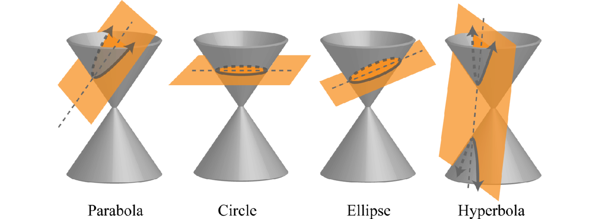

#L3CALC 

Author: Juyoung Park & Sedecember
`juyoung.parkk8@gmail.com` & `a3060100s@gmail.com`

---

Ever wondered how the formulas for parabolas, ellipses, circles, and hyperbolas came out?

This conic sections note includes the derivation of the following general formulas:
- Parabola
- Ellipse & Circle
- Hyperbola

These derivations are the summary of our notes that come from self-studying the conic sections topic outside of school with my friend Sed.

Sed and I have derived these formulas during the 2-week school holidays to help our attempt at the NZ Scholarship Calculus examination (and also because we were bored and had nothing to do...).

Since these formula derivations were *self-taught* from basically nothing but the definitions of parabolas, ellipses, circles and hyperbolas, some information may be inaccurate, and require fact-checking. 

---

'Conic sections', is basically the shape of the cross sectional shape when you intersect a plane to a cone like this

Image from <a href="https://saylordotorg.github.io/text_intermediate-algebra/s11-conic-sections.html">here<a>
