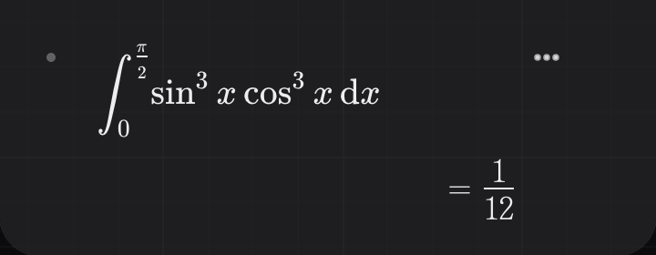
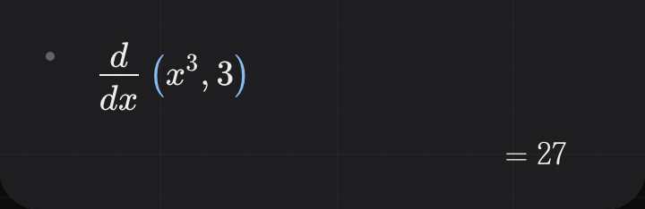
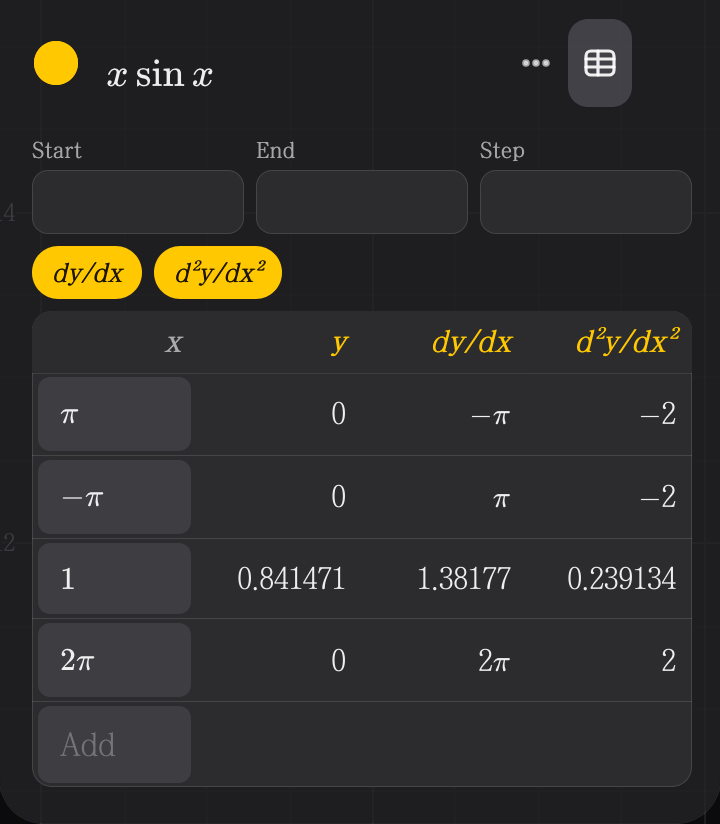
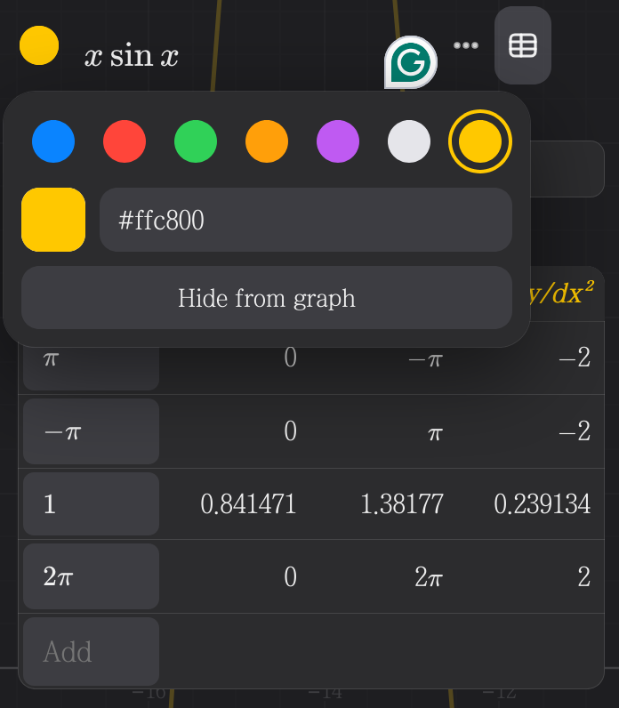

This post will be a bit different from the other posts that are related to mathematics or other subjects.

Since last year, I wanted to create a graphing calculator -- something that's in the design that I like, and has enough functionality to help me for L2 and L3 calculus.

So I created '[Arki](https://wndx2.github.io/arki)' with Claude. It's vibe coded, so it's quite buggy at the moment, but it should be good enough.

The main features that I have added (that isn't obvious [like "can draw graphs"]) are:
1. It's vibe coded 💀
2. You can use definite integrals like this:

3. You can use derivatives (and second derivates) of a function at a point

4. You can customize the color of the graphs (literally ANY color that you can write as HEX)

5. You can convert between light and dark mode

---

I'm still adding more features, since it's in the middle of development. Feel free to suggest more features by contacting juyoung.parkk8@gmail.com, or DM me on Discord `@wndx2`.

