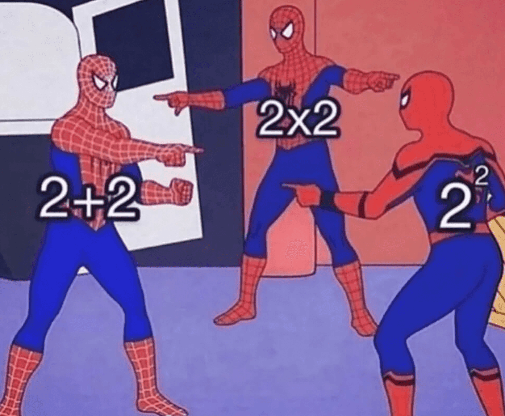

Welcome to Ni Brain Too Sht!\
<i style="opacity: 30%">Ni Brain Too Sht means that your brain is too sht /j</i>

Ni Brain Too Sht is an archive of all the notes, questions, and tutorials I made for myself, my juniors, my mentees, and/or my friends for NCEA Mathematics and Calculus. Being created in March 2026, Ni Brain Too Sht aims to be a reliable resource archive for NCEA mathematics and calculus students.

    
    
send me math memes and I'll put it here

We have ALL the NZQA past papers for L2, L3 and Scholarship mathematics and calculus.\
They can be found [here](Past-Papers.md)!

We also have *some* resources for [Chemistry](Non-mathematics/Chemistry/) and [Physics](Non-mathematics/Physics/); however our main focus is mathematics and calculus.

---

> *This page may contain mistakes. If you spot one, feel free to shoot me an email to: `22222w@duck.com`, or feel free to fix it yourself.*
