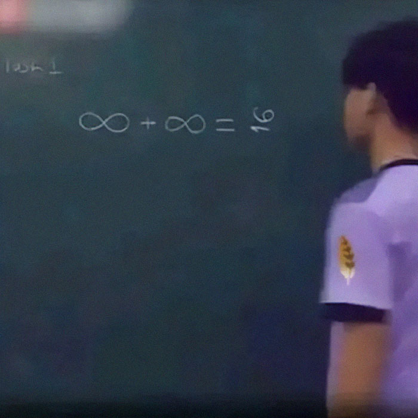

%%
HOW THIS PAGE WORKS (notes between the percent signs are hidden on the website)
- banner: (above) is the doodle strip under the top bar. Change the path to swap the image.
- [!polaroid] is the taped photo on the right. The title after it is the handwritten caption.
- [!sticky] is the yellow sticky note on the right. **Bold** text inside it is the date.
- Keep the polaroid and sticky note at the TOP of this file so they sit beside the text on laptops.
  (On phones they move below the "where to?" list automatically.)
- A plain "> " line is a handwritten side note.
%%

> [!polaroid] meme of the week
> 

> [!sticky] < new stuff >
> **31 Oct**: NEW HOMEPAGE
>
> **30 Oct**: practice excellence Qs for L2 Math!
>
> **earlier**: all Chem + Physics papers (L2 & L3). also grade emojis like: :merit:

# Welcome to ==Ni Brain Too Sht==!

> ↳ Ni Brain Too Sht means your brain is too sht /j

Ni Brain Too Sht is an archive of all the notes, questions and tutorials I made for myself, my juniors, my mentees and my friends for NCEA mathematics and calculus.

There's also every NZQA past paper for L2, L3, and Scholarship Calculus, plus L2 and L3 chemistry & physics.

%%
"where to?" list: one numbered line per row.
- **Bold** text is the row name. The links after it go on the right, after the dotted line.
- Add ==new!== after the bold name to get the handwritten "new!" arrow.
%%

> [!where-to] where to?
> 1. **Maths & Calculus past papers** [L2](Past-Papers.md#level-2) · [L3](Past-Papers.md#level-3) · [Scholarship](Past-Papers.md#scholarship)
> 2. **Practice excellence questions** ==new!== [91261 Algebra](Past-Papers/L2/Algebra/91261-practice-excellence.pdf) · [91262 Calculus](Past-Papers/L2/Calculus/91262-practice-excellence.pdf)
> 3. **Chemistry past papers** [L2](Non-Mathematics/Chemistry/Past-Papers.md#level-2) · [L3](Non-Mathematics/Chemistry/Past-Papers.md#level-3)
> 4. **Physics past papers** [L2](Non-Mathematics/Physics/Past-Papers.md#level-2) · [L3](Non-Mathematics/Physics/Past-Papers.md#level-3)
> 5. **Notes** [Level 2](Mathematics/Level-2/) · [Level 3](Mathematics/Level-3/) · [Scholarship](Mathematics/Scholarship/)
> 6. **Want to help? Contributing** [read this](Others/CONTRIBUTING.md)

> psst… want to pick the next theme colour? DM me **@sleepywndud** on Discord / Instagram :heart: